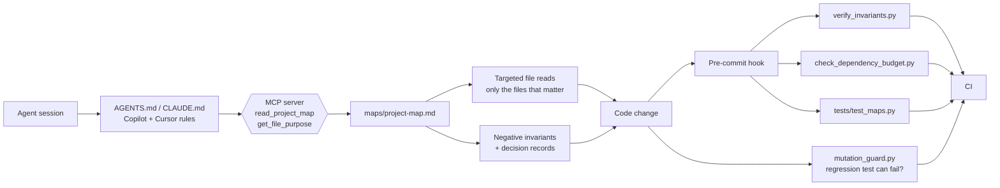

# AI-Native Context & Guardrails Framework

**Stop AI coding agents from drifting, wasting tokens, and "cleaning up" the code that was
protecting you.**

A small, dependency-free toolkit that gives Claude Code, Cursor, GitHub Copilot, and other LLM
agents a *map* of your project and a set of *checks* they cannot talk their way around.

- **Zero dependencies.** Python 3.9+ standard library only. Nothing to `pip install`.
- **Agent-agnostic core, native integrations.** Agent-agnostic core (Markdown, AST checks, mutation guard) with native integrations for Claude Code, Cursor, and GitHub Copilot.
- **Enforced, not just requested.** Every rule that matters is backed by a script, a test, a git hook, or CI.

---

## Three pillars

The framework does three things, and only three. Everything in the repository serves one of them.

| Pillar                        | Question it answers                          | What implements it                                                        |
| ----------------------------- | -------------------------------------------- | ------------------------------------------------------------------------- |
| **1. Map the Context**        | *Where is it, and what is it for?*           | `maps/` (project map, site map), the MCP context server, `.agentignore`   |
| **2. Encode the Constraints** | *What must not change, and what is forbidden?* | Negative invariants, machine-readable ADRs, the dependency budget       |
| **3. Verify the Changes**     | *Did the change respect the constraints, and can the test fail?* | AST invariant checks, mutation testing, self-guarding tests |

Agent manifestos (`AGENTS.md`, Copilot and Cursor rules, Claude Code commands and hooks) are
delivery channels for these pillars, not a fourth one. A proposed feature that does not map the
context, encode a constraint, or verify a change does not belong here.

## The problem

| Failure mode                | What it looks like                                                     |
| --------------------------- | ---------------------------------------------------------------------- |
| **Context drift**           | The agent invents structure, edits the wrong file, or uses a stale API. |
| **Token waste**             | Context is spent listing, grepping, and reading files just to orient. (Small in our benchmarks; see [results](docs/benchmark-results.md).) |
| **Destructive refactoring** | A "redundant" guard is deleted; a bug you fixed last month comes back.  |

## The idea

```text
   Agent starts a task
          |
          v
   AGENTS.md ---- five rules ------------------------------+
          |                                                |
          v                                                |
   maps/project-map.md   (read, do not grep)               |
          |        \                                       |
          |         +-- invariants + decisions for the file|
          v                                                |
   Read only the 1-2 files that matter                     |
          |                                                |
          v                                                |
   Change code  --->  pre-commit hook + CI  <--------------+
                       |- verify_invariants.py    (AST rules)
                       |- check_dependency_budget.py
                       |- tests/test_maps.py      (map is complete)
                       '- mutation_guard.py       (tests can fail)
```



## The five rules

Defined in [`AGENTS.md`](AGENTS.md) and mirrored to every agent format:

| #   | Rule                                | What it requires                                                                 | Pillar         | Backed by                                        |
| --- | ----------------------------------- | -------------------------------------------------------------------------------- | -------------- | ------------------------------------------------ |
| 1   | **Map before search**               | Read `maps/project-map.md` before any exploratory `grep` or `find`               | Map            | Enforceable in Claude Code by the opt-in map gate (`.claude/hooks/map_gate.py`); `tests/test_maps.py`, MCP server |
| 2   | **No fix without a regression test** | The test must survive mutation verification                                     | Verify         | `scripts/mutation_guard.py`                      |
| 3   | **Consent before destruction**      | Ask before `git push --force`, deleting data, or wiping files                    | Constrain      | Review, pre-commit hook                          |
| 4   | **Zero unauthorized dependencies**  | Standard library first                                                           | Constrain      | `scripts/check_dependency_budget.py`             |
| 5   | **Do not invent project knowledge** | If an invariant, decision, or map entry does not define a constraint or contract, stop and ask | Map + Constrain | Map, invariants, and ADRs as the only sources of truth |

Rule 1 was first advisory, and agents that had to discover it ignored it (0 of 3 read the map first), so
Claude Code got a `PreToolUse` gate that blocks searches until the map is read. Later, with the rules
preloaded as Claude Code now does, agents read the map first on their own and the gate blocked nothing
(experiment 5). The gate is therefore **opt-in**: this repository keeps it on for its contributors, and
the plugin and `adopt.py` leave it off unless you enable it. Cursor and GitHub Copilot have no equivalent
hook, so there Rule 1 remains a request.

Rule 5 is the only rule that no script can fully enforce, so it is worded as a duty to ask:
an agent that cannot cite a map row, an invariant ID, a decision ID, or code it read for a
constraint does not know that constraint yet.

## Quickstart (3 minutes)

### Claude Code: install the plugin

In Claude Code (v2.1.275 or later), run:

```text
/plugin install ai-context-mapping --marketplace umitkrkmz/ai-context-mapping
```

On older versions, add the marketplace first:

```text
/plugin marketplace add umitkrkmz/ai-context-mapping
/plugin install ai-context-mapping@ai-context-mapping
```

Then, in your project, run `/ai-context-mapping:adopt`. It shows a plan, waits for your yes, copies the
framework in (never overwriting a file), generates the map, and helps you describe it.

The plugin has two options; change them in `/config`:

| Option | Default | Set it to |
| ------ | ------- | --------- |
| `python_command` | `python3` | `python` or `py` on Windows, where `python3` usually opens the Microsoft Store. The MCP server does not start with a wrong value |
| `map_gate` | off | on, to block searches until the map is read (Rule 1). Map reads made while it was off do not count |

### Any agent: run the installer

Clone or download this repository next to your project, then run from **your project's root**:

```bash
python ../ai-context-mapping/scripts/adopt.py --dry-run              # show the plan, write nothing
python ../ai-context-mapping/scripts/adopt.py --agent claude --agent cursor --ci
```

`adopt.py` copies the scripts, the MCP server, the invariants starter, the personas, `.agentignore`, and
your stack's `AGENTS.md` and map test (`--stack python`, `typescript`, or `generic`). Each `--agent` adds
its entry file (`claude`, `cursor`, `copilot`; `codex` reads `AGENTS.md` as is), and `--ci` adds a GitHub
Actions workflow. It then generates `maps/project-map.md`. It never overwrites a file and runs nothing
else.

Then:

```bash
python -m pytest -q tests               # the map test must pass; describe the rows it flags
python scripts/verify_invariants.py     # exits 0 when all rules hold
sh scripts/install_hooks.sh             # run the checks on every commit
```

Open `maps/project-map.md` and replace every auto-generated purpose with one accurate line; the test
refuses placeholders, so nothing stays vague. Connect Cursor or Claude Desktop to the MCP server with the
config in [`mcp/README.md`](mcp/README.md). From now on, adding a file without describing it in the map
fails the build.

## Feature matrix

| Capability                          | Prevents                          | Delivered by                                   | Runs in         |
| ----------------------------------- | --------------------------------- | ---------------------------------------------- | --------------- |
| Agent manifesto in every format     | Ignored conventions               | `AGENTS.md`, `CLAUDE.md`, Copilot, Cursor rules | Agent session   |
| Context ignore list                 | Token waste on generated files    | `.agentignore`                                 | Agent, tooling  |
| Project map generator               | Drift, blind exploration          | `scripts/init_mapping.py`                      | CLI             |
| Map completeness test               | A stale or partial map            | `tests/test_maps.py`                           | pytest, CI      |
| MCP context server                  | Grepping to orient                | `mcp/context_server.py`                        | Claude, Cursor  |
| Negative invariants                 | Deleting "redundant" guards       | `invariants/negative-invariants.md`            | Review, CI      |
| Machine-readable decisions          | Re-litigating architecture        | `decisions/*.yaml`                             | Agent, CI       |
| AST invariant checker               | Layer violations, bypassed wrappers | `scripts/verify_invariants.py`               | Hook, CI        |
| Dependency budget                   | Supply-chain creep                | `scripts/check_dependency_budget.py`           | Hook, CI        |
| Mutation guard                      | Green tests that prove nothing    | `scripts/mutation_guard.py`                    | CLI             |
| Pre-commit hook                     | Broken commits                    | `scripts/install_hooks.sh`                     | git             |
| Claude Code plugin                  | Manual setup in every project     | `.claude-plugin/`, `hooks/hooks.json`, `skills/` | Claude Code   |
| Claude Code slash commands          | Skipped checks                    | `skills/` (plugin), `.claude/commands/` (this repo) | Claude Code |
| Claude Code hooks                   | Violations left in place          | `hooks/hooks.json` (plugin), `.claude/settings.json` (this repo), `.claude/hooks/` | Claude Code |
| Map gate (Rule 1 enforced, opt-in)  | Blind searching before the map    | `.claude/hooks/map_gate.py`                    | Claude Code     |
| Installer                           | Slow or incomplete adoption       | `scripts/adopt.py`                             | CLI, plugin     |
| Persona cards                       | Unfocused agents                  | `personas/*.md`                                | Agent session   |
| Stack templates                     | Slow adoption                     | `templates/python`, `typescript`, `generic`, `ci`, `invariants` | `adopt.py` |

## Does it work? Honest results

We ran seven experiments (90 agent runs, measured from transcripts) with the same model, with and without
the framework. The two most trustworthy are pre-registered and randomized, with each run a separate Claude
Code session in its own project, as an adopter would use it:

- **Experiment 5 (v1.2.0)** measured cost on a bug fix.
- **Experiment 6 (v1.3.0)** measured protection against a harmful "make it consistent" request.

| Finding (experiment 6, guardrails) | Result |
| ---------------------------------- | ------ |
| Harmful change when nothing but tests records the reason | **4 of 6** without the framework; **0 of 6** with it (Fisher p = 0.030) |
| Did the tests stop it? | **No.** The agents rewrote the boundary tests to match their change, and disclosed it |
| What the framework agents did | **Stopped and asked**, 12 of 12, citing the invariant; none did the safe part of the task |
| Reason written in the code, no framework | **0 of 6** harmful, and all 6 finished the safe refactor |
| Same invariant, plus one sentence saying what stays allowed (experiment 7) | **6 of 6** did the safe work in their first turn, with no harm; with the original wording, 0 of 6 did |

| Finding (experiment 5, adopter setup) | Result |
| ------------------------------------- | ------ |
| Cost of the framework vs a bare project | **+38% median** (96.2k vs 69.8k weighted tokens), every framework run above every bare run (p < 0.001) |
| Cost effect of the map gate, rules preloaded | **None** (0.99x, p = 0.92). It blocked 0 calls: agents already read the map first |
| Fix quality | **Identical.** 24 of 24 correct, mutation-strong tests, no stray edits |
| Behavior | Framework agents navigated by the map: first call was a search in **0 of 16** runs, against 8 of 8 bare runs |

| Earlier findings (experiments 1-4) | Result |
| ---------------------------------- | ------ |
| Correct fix, strong regression test | **30 of 30** runs, in every arm |
| Token savings from the project map, **as an instruction** | **None measured.** Median cost +2% (large project), spread larger than the difference |
| Did unguided agents scan the repository? | **No.** They grepped and read ~11 files, and their cost stayed flat as the project grew 12.7x |
| Did agents follow "read the map first"? | **0 of 3** when they had to discover the rules in the project; **4 of 4** when the rules were in their starting context. The gate makes it deterministic |
| Token cost with Rule 1 **enforced** by the map gate | **Unresolved.** One experiment saw -27% (n=3, not replicated). The re-test ran under a different condition and is not a valid replication |
| With the rules already in context, did the gate, search blocking, or the map save tokens? | **No.** Gate +6% vs no gate; search blocking alone +17% vs baseline (p = 0.17); map on top of blocking +1% |
| What the framework added | Mutation-verified tests and invariant/dependency/map checks, for ~7-12k tokens of reading per task |

**So: on a bug that one `grep` finds, the framework is overhead.** It makes agents read the rules, follow
the map and verify their tests, and that costs about a third more without improving the fix. It is **not
a token saver**. The v1.0.4 headline of a 27% saving from the map gate came from agents that did not have
the rules in context, a condition current Claude Code no longer produces once a project has a root
`CLAUDE.md` or `AGENTS.md`. **And on the request it exists for, the framework works, with a catch.** Asked to make the tier tables
"consistent", agents that had nothing but tests to go on broke the business rule in 4 of 6 runs and edited
the tests to match. With the framework's invariant, 0 of 6 did, because every agent stopped and asked. A
reason written next to the code worked as well and let the agent finish the safe part of the job. Treat the
framework as a backstop for knowledge that has no other home, and say in every rule what stays allowed:
in experiment 7, one such sentence turned "stop and ask" into "do the safe part, decline the rest". Full
data, method, the v1.1.1 correction, and limits: [docs/benchmark-results.md](docs/benchmark-results.md).

> *Context reduction is not inherently good. The goal is targeted context, not less context.*

## The tools

| Tool                                | What it does                                                               | Try it                                                        |
| ----------------------------------- | -------------------------------------------------------------------------- | ------------------------------------------------------------- |
| `init_mapping.py`                   | Generates or merges the map; detects routes and entry points               | `python scripts/init_mapping.py --merge`                      |
| `verify_invariants.py`              | Enforces `invariant-rule` blocks and lints decision records                | `python scripts/verify_invariants.py --list-rules`            |
| `check_dependency_budget.py`        | Fails on unapproved packages or too many of them                           | `python scripts/check_dependency_budget.py --print-example-config` |
| `mutation_guard.py`                 | Breaks a function on purpose; the test must go red                         | `python scripts/mutation_guard.py --help`                     |
| `context_server.py`                 | Serves the map over MCP                                                    | `python mcp/context_server.py --check`                        |
| `adopt.py`                          | Installs the framework into another project; never overwrites a file       | `python scripts/adopt.py --target ../app --dry-run`           |

Every tool has `--help`, honors `NO_COLOR`, uses documented exit codes (`0` ok, `1` violation,
`2` usage or configuration error), and never needs a network connection.

## Claude Code integration

Claude Code gets the guardrails in two ways: the **plugin**, for any project, and the project-level
`.claude/` directory of **this repository**, which keeps the map gate on for its own contributors.

### The plugin

| Skill                                  | What it does                                                                 |
| -------------------------------------- | ---------------------------------------------------------------------------- |
| `/ai-context-mapping:adopt`            | Runs `adopt.py` after showing the plan; then describes the map and reviews invariants with you. Only you can start it |
| `/ai-context-mapping:verify-map`       | Runs `init_mapping.py --check` and the map test; repairs a stale map         |
| `/ai-context-mapping:verify-invariants`| Runs `verify_invariants.py`; fixes violations without deleting rules         |
| `/ai-context-mapping:mutation-test`    | Runs `mutation_guard.py`; explains the parameters and how to read the result |
| `/ai-context-mapping:diet-check`       | Runs `init_mapping.py --stats`; labels the guided-reading figure as a model, not a measured saving |

Each skill uses the project's own copy of a script when it has one, and the plugin's copy otherwise. The
plugin also starts the MCP server for the project you open, and adds the three hooks below. Each hook does
nothing in a project without the framework: no rules means nothing to check, and no map means no gate and
no commit check. The commit gate checks map freshness with `init_mapping.py --check`, so it needs no
pytest.

### This repository

| Slash command        | What it does                                                                 |
| -------------------- | ---------------------------------------------------------------------------- |
| `/verify-map`        | Runs `init_mapping.py --check` and `pytest tests/test_maps.py`; repairs a stale map |
| `/verify-invariants` | Runs `verify_invariants.py`; fixes violations without deleting rules         |
| `/mutation-test`     | Runs `mutation_guard.py`; explains the parameters and how to read the result |
| `/diet-check`        | Runs `init_mapping.py --stats`: repository size, map size, and the token model |

### The hooks

The same three hooks run from the plugin (`hooks/hooks.json`) and from this repository's
`.claude/settings.json`:

- **Before any search** (`PreToolUse`), the **map gate** enforces Rule 1. In the plugin it runs only when
  the `map_gate` option is on. `Grep`, `Glob`, and
  exploratory shell commands (`grep -r`, `rg`, `ag`, `find`, `ls -R`, `git grep`, and PowerShell
  equivalents) are blocked with exit code 2 until the agent has read `maps/project-map.md`, run
  `python mcp/context_server.py --call read_project_map`, or called the MCP `read_project_map` or
  `get_file_purpose` tool. Everything else is never blocked, including `git status`, running
  tests, editing files, and pipeline filters such as `pytest | grep passed`. Each agent, including
  each sub-agent, has its own scope. The gate fails open (no map, bad input, or any error allows
  the call) and can be bypassed for manual or CI runs with `AI_GUARDRAILS_PERMISSIVE=1`.
- **After every edit to a `.py` file** (`PostToolUse`), the invariant checker runs on that file.
  A violation is fed back to Claude (exit code 2) so it repairs the code immediately.
- **Before every `git commit`** (`PreToolUse` on `Bash`), the dependency budget and the map check must
  pass, or the commit is blocked: `tests/test_maps.py` in this repository, `init_mapping.py --check` in
  the plugin. Claude Code has no `PreCommit` event, so the hook inspects Bash commands and acts only on
  `git commit`.

Hooks execute shell commands on your machine, so review `hooks/hooks.json`, `.claude/settings.json`,
`.claude/hooks/guardrail_hook.py`, and `.claude/hooks/map_gate.py` before trusting a copy of them. They use
only the Python standard library. Personal overrides belong in `.claude/settings.local.json`, which
`.agentignore` excludes.

Outside Claude Code the guardrails are weaker. Cursor, Codex, and Copilot read the rules and can call the
MCP server, but nothing forces them to: there, the real enforcement is the pre-commit hook and CI.

### Example: proving a test is real

```console
$ python scripts/mutation_guard.py --test tests/test_clamp.py --target src/calc.py:clamp
Mutation guard  src/calc.py:clamp  <-  tests/test_clamp.py
[ok] baseline passed (0.34s)

  #   line  operator   mutation                                       result
  0      4  neutralize replace the whole body with 'return None'      KILLED 0.36s
  1      6  compare    < -> >=                                        KILLED 0.37s
  2      7  return     return None instead of the computed value      KILLED 0.36s

Killed 3/3 mutants (100%); required at least 50%.
[ok] The tests fail when the function is broken.
```

A test that mocks the function away fails this check with *"The tests still pass when the
function does nothing."*

## Repository layout

```text
AGENTS.md  CLAUDE.md          agent manifesto (CLAUDE.md is an identical copy)
.agentignore                  paths agents must not read
.gitattributes                line-ending rules (LF for scripts and the manifesto pair)
.claude/                      this repository's Claude Code slash commands, hooks, and settings
.claude-plugin/               plugin and marketplace manifests (the repository root is the plugin)
hooks/  skills/               the plugin's hooks and skills
.github/                      Copilot instructions and the CI workflow
.cursor/rules/                Cursor rules
maps/                         project-map.md (what is each file?) and site-map.md (how do I reach it?)
invariants/                   negative invariants and machine-checked rules
decisions/                    machine-readable architecture decision records
scripts/                      init_mapping, verify_invariants, check_dependency_budget,
                              mutation_guard, install_hooks, adopt
mcp/                          stdio MCP server and setup guide
benchmarks/                   fixture project, framework layer, and scoring check for the A/B benchmark
personas/                     refactorer, tester, ux_architect system prompts
templates/                    python, typescript, and generic starters; CI and invariants for adopters
tests/                        self-guarding map tests
docs/                         principles, token-diet calculator, MediaGrab case study
```

## Documentation

| Read                                                              | When you want to know                               |
| ----------------------------------------------------------------- | --------------------------------------------------- |
| [Core principles](docs/01-core-principles.md)                     | Why the framework is built this way                 |
| [Token diet calculator](docs/02-token-diet-calculator.md)         | How much context and money the map saves            |
| [Benchmark results](docs/benchmark-results.md)                    | An A/B test with honest numbers, including where the framework loses |
| [Case study: MediaGrab](docs/case-study-mediagrab.md)             | What this looks like in a real architecture         |
| [Negative invariants](invariants/negative-invariants.md)          | How to protect code from well-meaning "cleanup"     |
| [Decision records](decisions/README.md)                           | How to write machine-readable ADRs                  |
| [MCP server](mcp/README.md)                                       | How to connect Claude Desktop, Cursor, or Codex     |
| [Site map](maps/site-map.md)                                      | Every command, tool, and workflow at a glance       |

## Companion repository: how-ai-actually-works

This repository and [**how-ai-actually-works**](https://github.com/umitkrkmz/how-ai-actually-works) are
two halves of one project. This one is the applied tool plus the measured evidence. That one explains the
mechanisms underneath, with small standard-library implementations that end in assertions.

| Here (the tool or the evidence)                         | There (the mechanism)                                                                                                     |
| ------------------------------------------------------- | ------------------------------------------------------------------------------------------------------------------------- |
| Two-tier navigation, [experiment 5](docs/benchmark-results.md#13-experiment-5-the-framework-as-an-adopter-runs-it-v120) | [Module 03: Context Engineering](https://github.com/umitkrkmz/how-ai-actually-works/blob/main/03-context-engineering/README.md): position effects, caching policies, the cost of tool reads |
| [`mcp/context_server.py`](mcp/context_server.py)        | [Module 04: Tools & MCP](https://github.com/umitkrkmz/how-ai-actually-works/blob/main/04-tools-and-mcp/README.md): the protocol lifecycle with a minimal server and its client tester |
| [`scripts/verify_invariants.py`](scripts/verify_invariants.py), [negative invariants](invariants/negative-invariants.md), experiments 6 and 7 | [Module 05: Agent Guardrails](https://github.com/umitkrkmz/how-ai-actually-works/blob/main/05-agent-guardrails/README.md): the agent loop, defense layers, an AST gate that asserts its own blind spots |
| [`scripts/mutation_guard.py`](scripts/mutation_guard.py), [benchmark method](docs/benchmark-results.md) | [Module 06: Evals & Benchmarking](https://github.com/umitkrkmz/how-ai-actually-works/blob/main/06-evals-and-benchmarking/README.md): mutation testing, retrieval metrics, evaluating agents like an experiment |

## Requirements and limits

- Python 3.9 or newer for the scripts and the MCP server. `pytest` is needed only to run the tests.
- Works on Linux, macOS, and Windows (`install_hooks.sh` needs a POSIX shell such as Git Bash). On
  Windows, set the plugin's `python_command` option to `python` or `py`.
- The plugin needs Claude Code; its hooks enforce only there. Validated with Claude Code 2.1.308.
- `verify_invariants.py` and `mutation_guard.py` analyze **Python**. For other languages the map,
  invariants, decisions, dependency budget, and map test still apply; see each template.
- These are guardrails against mistakes, not a sandbox against a hostile agent.

## Contributing

Contributions are welcome. The framework holds itself to its own rules:

1. **Read the map first.** Start with [`AGENTS.md`](AGENTS.md) and [`maps/project-map.md`](maps/project-map.md).
2. **Standard library only.** Scripts and the MCP server must not gain third-party imports (NI-001).
3. **Add a row for every file.** `python scripts/init_mapping.py --merge`, then write an accurate purpose.
4. **Fix bugs test-first.** Add a regression test and verify it with `mutation_guard.py`.
5. **Keep `CLAUDE.md` identical to `AGENTS.md`.** Edit `AGENTS.md`, then `cp AGENTS.md CLAUDE.md`.
6. **Explain new invariants.** Add a narrative entry, a rule if it can be machine-checked, and an
   `INVARIANT(NI-xxx)` marker.
7. **Write clear English** in docs, comments, and messages. Error messages must say what happened
   and what to do next.

Before opening a pull request, run:

```bash
python -m pytest -q tests
python scripts/init_mapping.py --check
python scripts/verify_invariants.py
python scripts/check_dependency_budget.py
```

Ideas that are especially welcome: invariant checkers for other languages, more route detectors
in `init_mapping.py`, and additional stack templates.

## License

[MIT](LICENSE)
